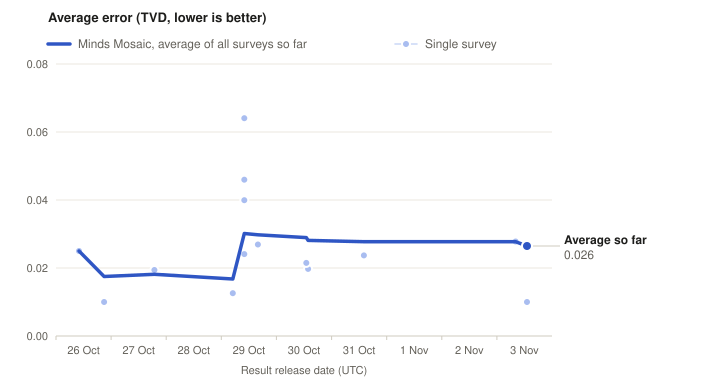

# Minds Mosaic forecast ledger

We forecast the answers to real public surveys with Minds Mosaic before the survey is in the field or before its result is released. Every forecast is hashed into an append-only ledger and timestamped in the Bitcoin blockchain with OpenTimestamps, so anyone can check that it existed before the deadline. While a survey is pending only the hashes are public. Once the publisher releases its result, every locked forecast is scored, misses included.

## Scorecard

Across 13 scored surveys and 77 questions, Minds Mosaic has an average distribution error (TVD) of 0.034. Average miss per answer option: 1.37 percentage points. Correlation between forecast and actual answer shares: 0.993. On the 4 surveys locked before fieldwork began (19 questions): 0.023.

Lower is better for TVD and miss. TVD is 0 for a perfect forecast and 1 for a completely wrong one. All figures are for the full surveyed population.



Each dot is one scored survey, placed at the date its result was released. The thick line is the average error of all surveys released so far, with every survey weighted equally (the pooled figure above weights every question equally). Surveys whose publisher does not allow republication are not shown.

| Evidence type | Surveys | Questions | Minds Mosaic TVD | Minds Mosaic miss (pp) |
|---|---:|---:|---:|---:|
| Attitude | 12 | 62 | 0.036 | 1.49 |
| Stated intent | 10 | 15 | 0.025 | 0.89 |
| Behaviour | not scored yet | | | |

Attitude: opinions and ratings. Stated intent: what people say they will do. Behaviour: what people actually do.

The pooled figures include 1 survey whose publisher does not allow its data to be republished. It is listed in `index.json` with forecast hashes and lock times only.

### By survey

Each survey name links to the publisher's page for the release.

| Survey | First lock | Released | Questions | Minds Mosaic TVD | Minds Mosaic miss (pp) |
|---|---|---|---:|---:|---:|
| [The Economist/YouGov Poll (weekly, US registered voters)](https://yougov.com/en-us/articles/55847) | 2026-10-23 21:34 UTC | 2026-10-29 15:54 UTC | 54 | 0.045 | 1.75 |
| [YouGov GB weekly trackers (government approval, most important issues, Westminster voting intention)](https://yougov.com/en-gb/trackers/government-approval) | 2026-10-23 21:53 UTC | 2026-10-27 18:52 UTC | 30 | 0.037 | 2.76 |
| [Emerson College Polling national poll (US likely voters)](https://emersoncollegepolling.com/october-2026-national-poll-democrats-hold-10-point-midterm-advantage/) | 2026-10-24 01:48 UTC | 2026-10-30 12:58 UTC | 2 | 0.022 | 1.43 |
| [NPR/PBS News/Marist Poll (national, US registered voters)](https://maristpoll.marist.edu/wp-content/uploads/2026/10/NPR_PBS-News_Marist-Poll_USA-NOS-and-Tables_202610211808AS.pdf) | 2026-10-24 01:47 UTC | 2026-10-26 10:00 UTC | 2 | 0.025 | 1.02 |
| [Reuters/Ipsos poll (national, US adults, Ipsos KnowledgePanel)](https://www.ipsos.com/sites/default/files/ct/news/documents/2026-10/Reuters%20Ipsos%20October%20Core%20Political%20Topline%2010.26%20release.pdf) | 2026-10-24 01:46 UTC | 2026-10-26 20:56 UTC | 1 | 0.010 | 0.40 |
| [Find Out Now weekly GB Westminster voting intention](https://findoutnow.co.uk/blog/) | 2026-10-24 01:52 UTC | 2026-10-30 13:46 UTC | 2 | 0.020 | 0.58 |
| [Opinium / The Observer political poll (Westminster voting intention and leader approval)](https://www.opinium.com/resource-center/) | 2026-10-25 00:55 UTC | 2026-10-31 14:04 UTC | 2 | 0.024 | 0.71 |
| [European Commission Joint Harmonised Consumer Survey, France (INSEE monthly household survey CAMME), monthly questions Q1-Q8, Q11, Q12, October 2026](https://economy-finance.ec.europa.eu/economic-forecast-and-surveys/business-and-consumer-surveys/download-business-and-consumer-survey-data/time-series_en) | 2026-10-26 10:14 UTC | 2026-10-29 10:00 UTC | 10 | 0.064 | 2.28 |
| [European Commission Joint Harmonised Consumer Survey, Austria (fieldwork Ipsos, CCB Consumer Confidence Barometer), monthly questions Q1-Q9, Q11, Q12, October 2026](https://economy-finance.ec.europa.eu/economic-forecast-and-surveys/business-and-consumer-surveys/download-business-and-consumer-survey-data/time-series_en) | 2026-10-27 01:27 UTC | 2026-10-29 10:00 UTC | 11 | 0.046 | 1.62 |
| [European Commission Joint Harmonised Consumer Survey, Germany (fieldwork NIQ/GfK eBUS), monthly questions Q1-Q9, Q11, Q12, October 2026](https://economy-finance.ec.europa.eu/economic-forecast-and-surveys/business-and-consumer-surveys/download-business-and-consumer-survey-data/time-series_en) | 2026-10-27 01:08 UTC | 2026-10-29 10:00 UTC | 11 | 0.024 | 0.83 |
| [European Commission Joint Harmonised Consumer Survey, Spain (fieldwork NIQ/GfK eBUS), monthly questions Q1-Q9, Q11, Q12, October 2026](https://economy-finance.ec.europa.eu/economic-forecast-and-surveys/business-and-consumer-surveys/download-business-and-consumer-survey-data/time-series_en) | 2026-10-27 01:17 UTC | 2026-10-29 10:00 UTC | 11 | 0.040 | 1.41 |
| [Cabinet Office ESRI 消費動向調査 (Consumer Confidence Survey, monthly): consumer-attitude components and one-year price outlook, two-or-more-person households](https://www.esri.cao.go.jp/jp/stat/shouhi/honbun.pdf) | 2026-10-27 01:37 UTC | 2026-10-29 05:00 UTC | 5 | 0.013 | 0.49 |

Per survey, questions include audience subgroups where the publisher reports them.

## German Sonntagsfrage

"Wenn am nächsten Sonntag Bundestagswahl wäre ...": federal vote intention in Germany, as published by the regular polling institutes. Minds Mosaic forecasts each institute's next wave before its fieldwork starts. Scores compare the forecast party shares with the published result. Each institute links to the page where its results are published.

| Institute | Publication | Locked | Status | Minds Mosaic TVD |
|---|---|---|---|---:|
| [Forsa (RTL/ntv)](https://www.wahlrecht.de/umfragen/forsa.htm) | 2026-11-03 (expected) | 2026-10-24 01:50 UTC | locked | - |
| [Infratest dimap (ARD-DeutschlandTrend)](https://www.infratest-dimap.de/umfragen-analysen/bundesweit/ard-deutschlandtrend/) | November 2026 (expected) | 2026-10-24 02:07 UTC | locked | - |
| [INSA (BILD)](https://www.wahlrecht.de/umfragen/insa.htm) | 2026-11-03 (expected) | 2026-10-28 04:39 UTC | locked | - |
| [Forsa (RTL/ntv)](https://www.wahlrecht.de/umfragen/forsa.htm) | 2026-11-10 (expected) | 2026-11-01 12:16 UTC | locked | - |
| [Verian (Bild am Sonntag)](https://www.wahlrecht.de/umfragen/emnid.htm) | November 2026 (expected) | 2026-11-01 21:17 UTC | locked | - |
| [Allensbach (FAZ)](https://www.wahlrecht.de/umfragen/allensbach.htm) | November or December 2026 (expected) | 2026-11-01 21:19 UTC | locked | - |
| [GMS](https://www.wahlrecht.de/umfragen/gms.htm) | November or December 2026 (expected) | 2026-11-01 21:22 UTC | locked | - |
| [Forschungsgruppe Wahlen (ZDF-Politbarometer)](https://www.forschungsgruppe.de/Umfragen/Politbarometer/Archiv/Politbarometer_2026/) | 2026-11-13 (expected) | 2026-11-01 21:29 UTC | locked | - |

TVD: total variation distance between forecast and published party shares (0 is perfect). For the ZDF-Politbarometer the score uses the published projection.

## Additional research forecasts

Alongside Minds Mosaic we lock additional research forecasts for the same surveys. They are pre-registered and timestamped the same way and stay in the record whatever their score. They are listed under their ledger tag.

| Ledger tag | Forecasts locked | Surveys scored | Questions | TVD | Miss (pp) |
|---|---:|---:|---:|---:|---:|
| `pure` | 562 | 13 | 77 | 0.086 | 3.47 |
| `cellsS` | 237 | 0 | | | |
| `cellsH` | 237 | 0 | | | |
| `memory3` | 467 | 11 | 62 | 0.093 | 3.44 |
| `blend` | 51 | 4 | 38 | 0.052 | 1.87 |
| `bank3` | 95 | 0 | | | |
| `bankR3` | 95 | 0 | | | |
| `cohort` | 43 | 0 | | | |
| `xpub3` | 15 | 0 | | | |

## Status

As of 2026-11-02 13:20 UTC: 57 surveys, 2363 forecasts in 234 timestamped batches. 13 scored, 44 pending, 0 not scoreable. 561 of the forecasts are Minds Mosaic; the rest are additional research forecasts.

## Files

- [`index.json`](index.json): every locked survey with status, lock times, hashes, Bitcoin blocks and file paths. Start here.
- `forecasts/<survey>/<tag>.json`: the locked forecasts. Pending surveys list hashes and lock times only.
- `results/<survey>.json`: release date, source and scores. Released numbers appear only where the publisher allows it.
- `proofs/`: the hash chain (`index.jsonl`), batch manifests and their OpenTimestamps proofs.
- [`verify.py`](verify.py): checks all of it with plain Python 3.

## How to verify

```
git clone https://github.com/minds-ai-co/forecast-ledger.git && cd forecast-ledger
python3 verify.py            # hash chain, Merkle roots, timestamp proofs, index.json
python3 verify.py --online   # also checks each proof against the Bitcoin block header
```

A forecast counts only if its Bitcoin timestamp is before the deadline (`cutoff_utc` in `index.json`). The official OpenTimestamps client works too: `ots info proofs/batches/<batch>.json.ots`.

Ledger chain head `cf9a1a57cc651b472537951d24c4c53cdb1199cdb277a79c2f0749793e52bd3a`.
